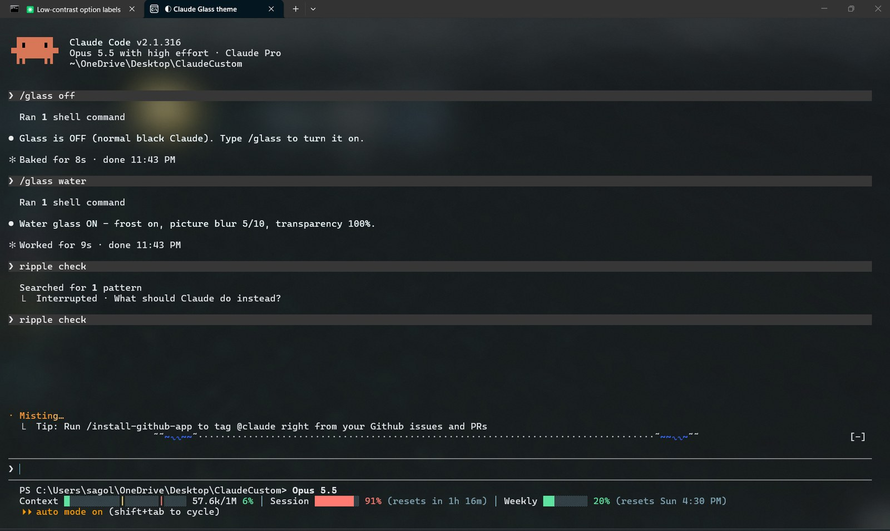
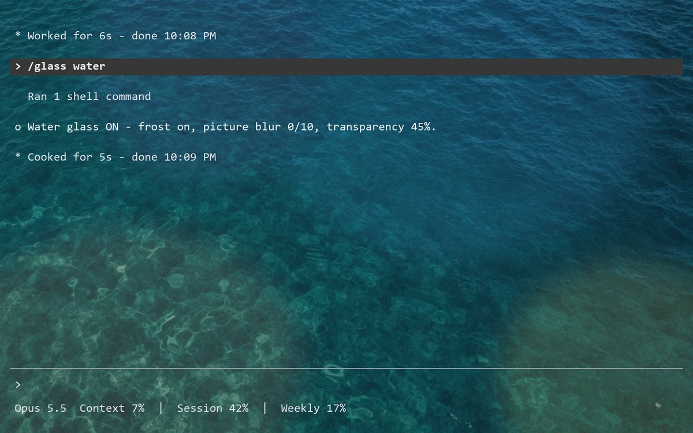
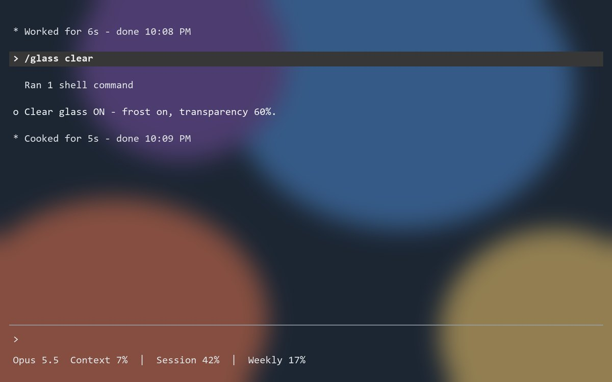
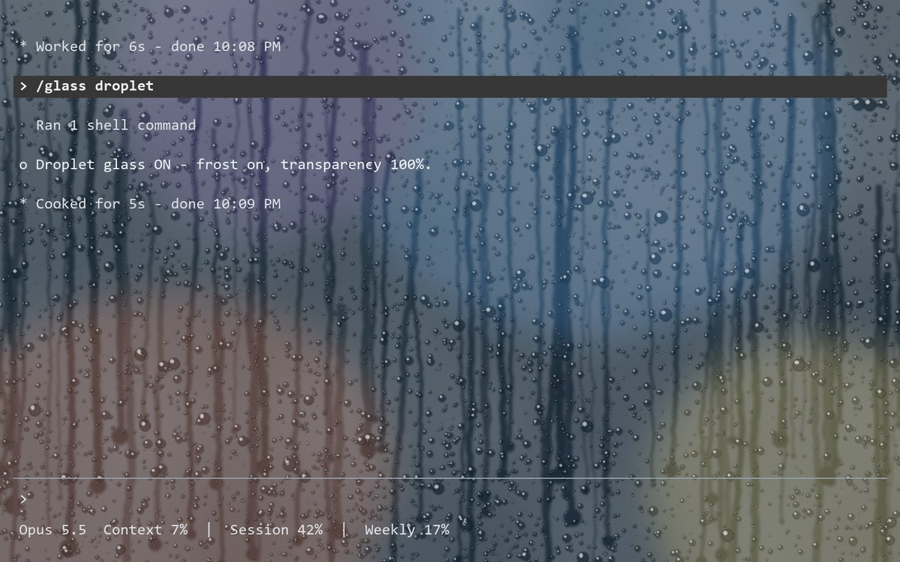
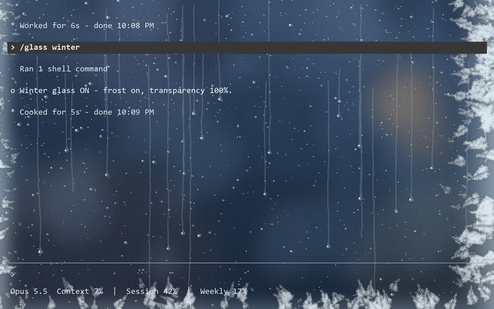
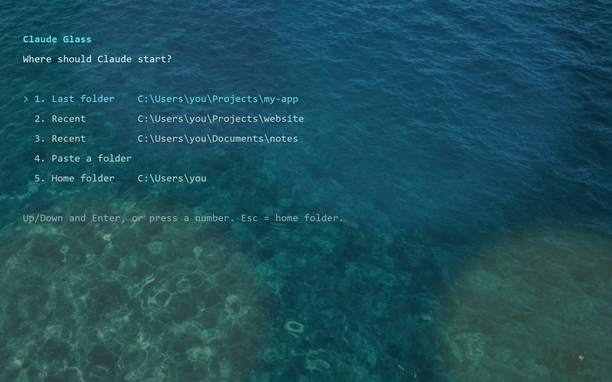

# claude-statusline

A Claude Code status line for Windows (PowerShell 5.1+) that shows:

```
PS C:\path\to\folder> Opus 5.5
Context ██░░░░░░░░|░░░░░░|░░░░ 65k/1M 6% │ Session █░░░░░░░ 2% (resets in 4h 45m) │ Weekly █████░░░ 58% (resets Sun 4:30 PM)
```

- **Context**: how full the current session's context window is. The yellow `|` at 50% marks a good time to start a new session or run `/compact`; the red `|` at 80% marks the red zone.
- **Session**: the 5-hour plan usage limit and when it resets.
- **Weekly**: the 7-day plan usage limit and when it resets.

Bars are green below 50%, yellow from 50%, red from 80%.

## Install

**Easiest:** paste this repo's link into Claude Code and say "install this". Claude will ask which parts you want and set them up (see [Instructions for Claude](#instructions-for-claude)).

Or install the status line yourself:

```powershell
git clone https://github.com/GegarinSagolsem/claude-statusline.git
cd claude-statusline
powershell -NoProfile -ExecutionPolicy Bypass -File .\install.ps1
```

Then restart Claude Code. It applies to every Claude Code terminal session on that PC, in any folder.

`install.ps1` copies `statusline.ps1` to `%USERPROFILE%\.claude\` and sets the `statusLine` entry in `%USERPROFILE%\.claude\settings.json`, keeping all other settings (a backup is saved as `settings.json.bak`).

## Subagent model labels (plugin)

`agent-models` is a Claude Code plugin that adds a band above the prompt listing each running subagent with the model it runs on:

```
[Haiku 5.5] Explore  Find the config files
[Opus 5.5] game-coder  Build playtest 10-13 batch
```

Install it at the Claude Code prompt (answer `y` to add the marketplace, then pick the user scope):

```
/plugin install agent-models --marketplace GegarinSagolsem/claude-statusline
```

## Water ripple (plugin)

`water-ripple` sends a ripple ( `≈ ∿ ~ ˜ ·` ) across the band above the prompt each time you press Enter:

```
/plugin install water-ripple --marketplace GegarinSagolsem/claude-statusline
```



It looks best with the [Claude Glass theme](#claude-glass-theme-windows-terminal) below.

## Claude Glass theme (Windows Terminal)

Gives Claude Code its own glass window in Windows Terminal, with four looks:

- **Water glass**: a turquoise water picture behind the text, under frosted glass.
- **Clear glass**: no picture; your desktop shows through the window.
- **Droplet glass**: misty glass with drip streaks and water droplets.
- **Winter glass**: a winter window at dusk, with soft blue lights, melt streaks with hanging drops, and fern frost along the edges.

| Water glass | Clear glass |
|---|---|
|  |  |
| **Droplet glass** | **Winter glass** |
|  |  |

Only the "Claude Glass" tab changes. Your other terminal tabs stay as they are.

### Install

```powershell
powershell -NoProfile -ExecutionPolicy Bypass -File .\glass\install-glass.ps1
```

This copies the theme files to `%USERPROFILE%\.claude\glass\`, adds the `/glass` command to `%USERPROFILE%\.claude\commands\`, and adds a "Claude Glass" profile to Windows Terminal (a backup of the Terminal settings is saved as `settings.json.bak`).

### Open it

In Windows Terminal, click the down arrow (⌄) next to the **+** tab button and pick **Claude Glass**. A small menu asks where Claude should start:



Use the arrow keys and Enter, or press a number. Enter on its own picks the first choice, and Esc picks your home folder. The recent folders come from Claude's own history, with the one you used last at the top. `C:\Windows` (including system32) is never offered. Claude then starts in that folder, and asks whether you trust it if it's new.

### Commands

Everything is one command, `/glass`. Type it inside Claude Code in the Claude Glass tab. Changes show up right away, and each command tells you what's on now.

| Type this | What it does |
|---|---|
| `/glass` | Turn glass on or off |
| `/glass water` | Water look |
| `/glass clear` | Clear look (your desktop shows through) |
| `/glass droplet` | Droplet look (misty glass with drips and droplets) |
| `/glass winter` | Winter look (winter window with fern frost) |
| `/glass off` | Normal black Claude (`/glass on` brings glass back) |
| `/glass frost on` / `/glass frost off` | Frosted glass over your desktop. `off` lets you see your desktop sharply |
| `/glass blur 0-10` | Blur the water picture: 0 = sharp, 10 = very blurry. In the other looks, `blur` works the same as `frost` |
| `/glass transparency 0-100` | 0 = solid, 100 = fully see-through |
| `/glass status` | Show what's on now, without changing anything |
| `/glass help` | List these commands |

You can put several in one line, for example `/glass water frost off blur 3 transparency 60`.

Frost, blur and transparency change the look you're in. Each look remembers its own settings.

Notes:

- The droplet and winter pictures (`glass/droplet.png`, `glass/winter.png`) are drawn by `glass/make-glass-pictures.py`. The droplet look also dims the desktop behind the glass so text stays readable. The water picture's blur is made by blurring the picture itself.
- If you see no transparency, turn on Windows **Settings → Personalization → Colors → Transparency effects**. The blur also fades while the window is not focused.
- If the commands don't show up in the `/` menu, restart Claude Code.

## Instructions for Claude

This section is for Claude Code. If a user gives you this repo's link and asks you to install it:

1. **Check the system.** Everything here is for Windows (PowerShell and Windows Terminal). On macOS or Linux, tell the user it won't work there and stop.
2. **Ask which parts they want** (all four if they don't mind):
   - **Status line**: context, session and weekly usage bars under the prompt. It replaces any status line they already have (`settings.json` is backed up first), so mention that if they have one.
   - **Claude Glass theme**: glass looks for a separate "Claude Glass" tab in Windows Terminal, with the `/glass` command. Needs Windows Terminal.
   - **agent-models plugin**: labels each running subagent with its model.
   - **water-ripple plugin**: a small ripple above the prompt each time they press Enter.
3. **Clone the repo** (it's public, no sign-in needed) and work from its folder:
   `git clone https://github.com/GegarinSagolsem/claude-statusline.git`
4. **Install the chosen parts:**
   - Status line: `powershell -NoProfile -ExecutionPolicy Bypass -File .\install.ps1`
   - Claude Glass theme: `powershell -NoProfile -ExecutionPolicy Bypass -File .\glass\install-glass.ps1`
   - Plugins: `claude plugin marketplace add GegarinSagolsem/claude-statusline`, then `claude plugin install agent-models@gegarin-claude --scope user` and/or `claude plugin install water-ripple@gegarin-claude --scope user`
5. **Check it worked.** Each installer prints what it changed. If one fails, show the user the error instead of retrying quietly. To test the status line, pipe sample data into it:
   `'{"cwd":"C:\\x","model":{"display_name":"Opus"},"context_window":{"context_window_size":1000000,"used_percentage":6,"current_usage":{"input_tokens":60000}}}' | powershell -NoProfile -ExecutionPolicy Bypass -File "$env:USERPROFILE\.claude\statusline.ps1"`
6. **Tell the user what to do next:**
   - Restart Claude Code to see the status line and plugins.
   - For the glass theme: in Windows Terminal, click the down arrow next to **+**, pick **Claude Glass**, choose a folder, then type `/glass help`.

To update later: `git pull` in the repo folder, then run the same installers again.

## License

MIT. See [LICENSE](LICENSE).
